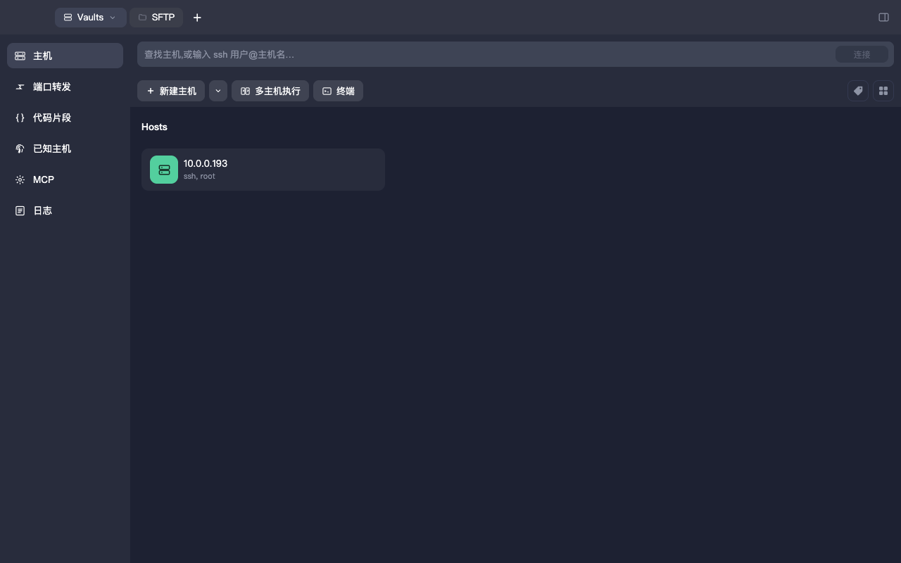
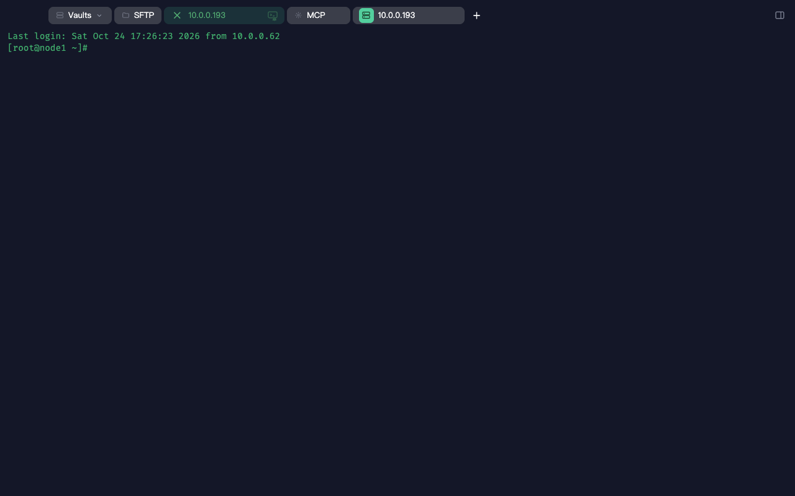
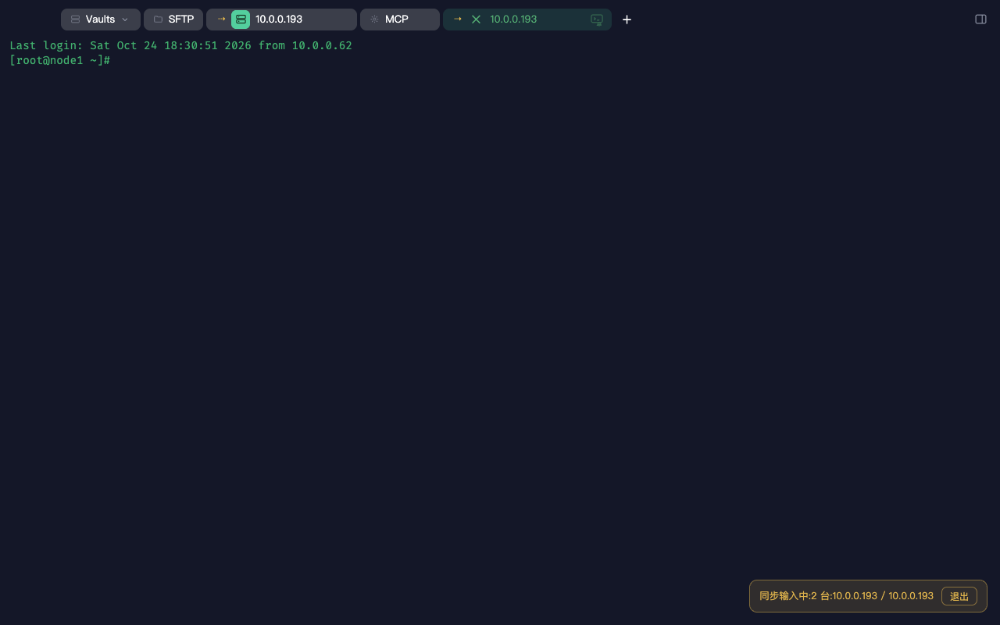
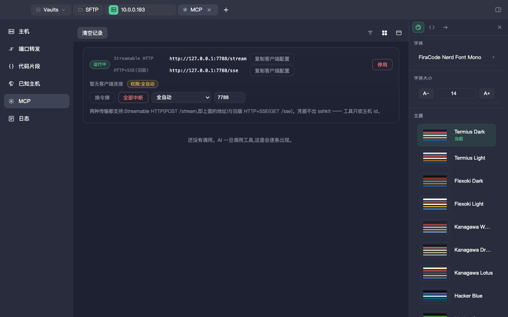

# sshkit

**中文** | [English](./README.en.md)

一个**本地优先**的 SSH 客户端:macOS 桌面应用,数据全部留在本机 —— 没有账号、没有云同步、没有遥测。
Electron + TypeScript + xterm,**独立实现**。

> 行为参考了对一款商业 SSH 终端的本地只读研究;**未复用该产品的任何代码、二进制或资源**。

## 当前版本

`0.1.0-rc.3`(pre-release)→ [Releases](https://github.com/suninx/sshkit/releases)

## 截图

| 主机簿 | 终端 |
|---|---|
|  |  |

| 广播输入(两台同时执行) | MCP(AI 接入) |
|---|---|
|  |  |

## 功能

### 连接与终端
- **SSH**:密码 / 私钥 / ssh-agent;known-hosts 校验(首次 TOFU 弹窗确认、哈希存储、可从别的
  `known_hosts` 导入);断线自动重连
- **终端**:xterm 渲染,64 套配色,字体与字号可调(随包 3 款 Nerd Font),5000 行回滚,
  全文搜索,水平分屏
- **广播输入**:多个会话标签各自右键「加入同步输入」,在任意一个终端输入 → 同组主机**同时执行**;
  危险命令(`rm -rf` / `mkfs` / `dd of=` / `shutdown` / fork 炸弹…)回车前弹确认
- **多主机命令面板**:不开终端也能勾选主机批量执行一条命令,结果并排显示(退出码/耗时/输出),
  支持并行/串行、全部中断

### 文件与网络
- **SFTP**:本地 ↔ 远端双栏浏览,递归传输、断点续传、冲突策略(覆盖/跳过/重命名)、
  拖拽上传、队列与取消、右键菜单(打开/重命名/删除/下载/上传/chmod)、Reload
- **端口转发**:本地 / 远端 / 动态(SOCKS5),规则持久化与实时状态

### 组织与效率
- **主机簿**:分组、标签、搜索、编辑删除;凭据存系统钥匙串(Keychain / libsecret / 凭据管理器)
- **加密备份**:「主机簿 → 更多」可导出/导入整份主机簿 —— 导出时手动设置密码,
  文件用 **AES-256-GCM**(scrypt 派生密钥)加密,已存的主机密码/私钥口令一并加密,
  私钥认证会把私钥文件一起打包;导入时输同一个密码,按主机去重恢复
- **代码片段**、**日志**、**已知主机**管理
- **右侧栏(two-panel)**:外观(字体/字号/主题)、代码片段、跳转三个 tab
- **外观**:深浅色界面、终端主题、字体与字号;侧栏与主界面共用同一套外观数据
- **国际化**:中文 / English,运行时可切换,默认跟随系统

### MCP(AI 接入)
sshkit 自身可作为一个 **MCP 服务器**,让 AI 助手直接操作你的服务器:

- **两种传输**:
  - Streamable HTTP:`POST/GET/DELETE http://127.0.0.1:7788/stream`(`/mcp` 为兼容别名)
  - 旧版 HTTP+SSE:`GET http://127.0.0.1:7788/sse` + `POST /messages?sessionId=…`
  - 鉴权:`Authorization: Bearer <token>`,token 存系统钥匙串;界面里可**按协议单独复制**客户端配置
- **12 个工具**:4 读(`list_hosts` / `sftp_list` / `sftp_read_file` / `sftp_stat`)
  + 7 写(`sftp_mkdir` / `sftp_rename` / `sftp_remove` / `sftp_chmod` / `sftp_write_file` /
  `sftp_upload` / `sftp_download`)+ 1 执行(`ssh_exec`)
- **看得见**:MCP 分区实时活动流;`ssh_exec` 会开「AI 执行」标签页回放输出,可一键**接管**成真实终端
- **三档权限**:只读 / 标准(写与执行前弹「允许/拒绝」)/ 全自动
- **STOP**:一键中断所有在跑的调用
- **审计**:每次调用追加 JSONL 到 `userData/mcp-audit.jsonl`(参数脱敏)
- **端口**:默认 7788;被占用自动顺延并把新端口写回设置,界面显示「X 被占用,已改用 Y」
- **凭据不经过 MCP**:工具只收主机 id/名字,密码与私钥仍由本地钥匙串注入

## 安装

### 下载安装包

| 平台 | 安装包 | 绿色版(免安装) |
|---|---|---|
| macOS (Apple Silicon) | `sshkit-*-arm64-mac.dmg`(打开后拖进「应用程序」) | `sshkit-*-arm64-mac.zip`(解压即用) |
| Windows x64 | `sshkit Setup *.exe`(NSIS 安装包) | `sshkit *.exe`(单文件便携版)或 `sshkit-*-win.zip` |
| Linux x64 | — | `sshkit-*.AppImage`(单文件)或 `.tar.gz` |

> 预发布安装包**未签名/未公证**:macOS 首次打开需右键 → 打开;Windows SmartScreen 会提示。

### 从源码运行

前置:**Node ≥ 22.12**、**pnpm 11**。

```sh
pnpm install
pnpm run rebuild:pty     # 按 Electron ABI 重建 node-pty
pnpm start               # 构建并启动
```

打包(产物在 `release/`):

```sh
pnpm dist                # 当前平台 zip(未签名)
pnpm run dist:dmg        # macOS dmg
pnpm run dist:dir        # 未打包 .app,便于排查
```

CI 在各自原生 runner 上构建三平台产物(macOS arm64 / Windows x64 / Linux x64):
`test`、`e2e`、`package` × 3 平台。每个平台同时产出**安装包与免安装版**:
macOS 为 dmg / zip,Windows 为 NSIS Setup.exe / 单文件 portable.exe / zip,
Linux 为 AppImage / tar.gz。

## 开发

```sh
pnpm run typecheck       # tsc --noEmit
pnpm test                # 单元 / 集成(vitest)
pnpm run test:e2e        # 端到端(Playwright 驱动真实 Electron)
pnpm run test:coverage   # 覆盖率(阈值固定 100%)
pnpm run test:all        # typecheck + 单元 + 构建 + e2e
```

约定与红线见 **[`AGENTS.md`](./AGENTS.md)**:测试锁*期望行为*,覆盖率不打折,修 bug 必须带回归用例,
i18n 中英双语,提交信息规范。项目历史与交接见 **[`HANDOVER.md`](./HANDOVER.md)**。

## 已知限制

- **MFA / keyboard-interactive 未支持** —— 开了 2FA 的服务器目前连不上
- 明确不做:串口、`~/.ssh/config` 导入、密钥生成/导入、证书 / Touch ID / FIDO2、ProxyJump、mosh
- 安装包未签名

## License

[Apache License 2.0](./LICENSE) © 2026 suninx — 见 [NOTICE](./NOTICE)。

第三方组件与随包字体的许可见 [`THIRD-PARTY.md`](./THIRD-PARTY.md)。
